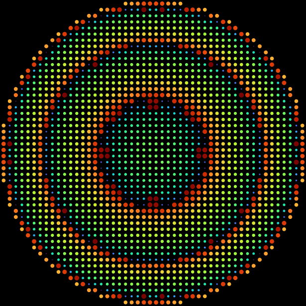
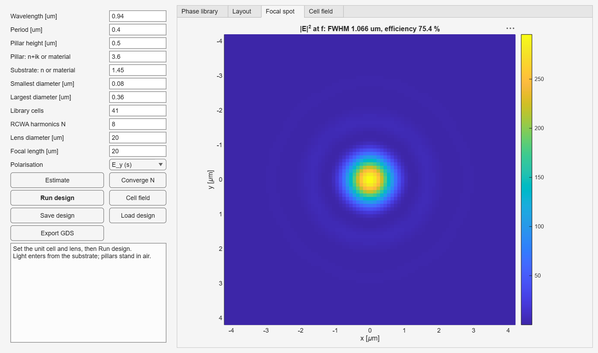
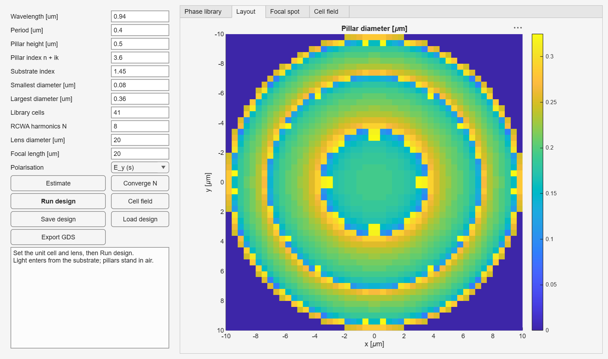
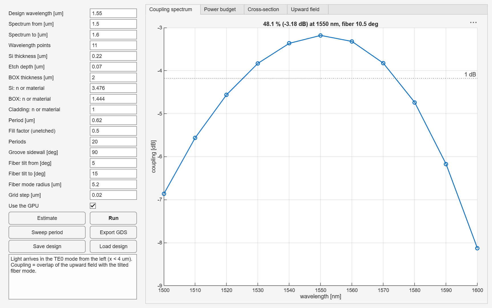
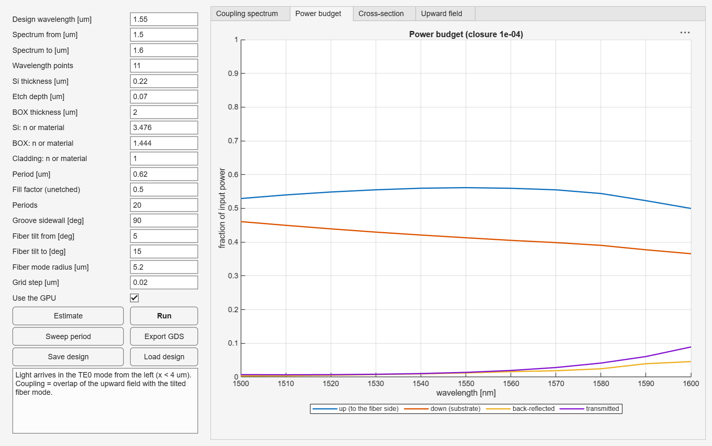
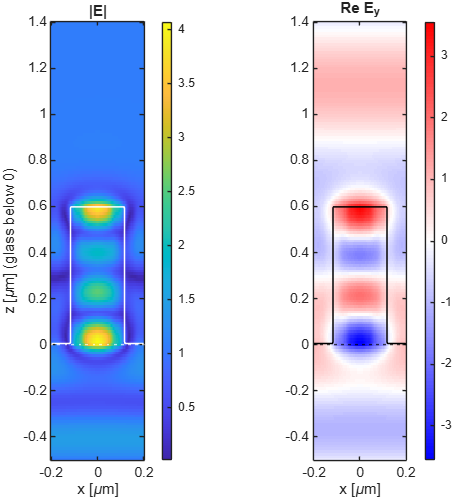

<p align="center">
  
</p>

<h1 align="center">OpticRCWAFDTD</h1>

<p align="center">
  <b>RCWA, FDTD and mode solvers for MATLAB — with metalens and fiber-coupler design apps</b><br>
  <b>MATLAB 光學 RCWA／FDTD／模態求解器 — 內建超穎透鏡與光纖耦合器設計介面</b>
</p>

<p align="center">
  
  
  
  
</p>

---

Rigorous electromagnetic solvers written in MATLAB, with ready-made design flows for
**metalenses** and **silicon-photonics fiber couplers (CPO)**. Every solver is
validated against exact references and an independent code.

以 MATLAB 實作的嚴格電磁數值求解器，內建 **超穎透鏡（metalens）** 與
**矽光子光纖耦合（CPO）** 設計流程。每個求解器都經過精確解與外部程式交叉驗證。

**Contents · 目錄**：
[Apps 介面](#apps--圖形介面) ·
[Features 功能](#features--功能) ·
[Validation 驗證](#validation--驗證) ·
[Install 安裝](#install--安裝) ·
[Quick start 快速開始](#quick-start--快速開始) ·
[Examples 範例](#examples--範例) ·
[Limitations 限制](#known-limitations-v01--已知限制v01) ·
[License 授權](#license--授權)

---

## Apps · 圖形介面

Two apps cover the full design flow without writing code. Type the name in the
MATLAB Command Window:

兩個圖形介面涵蓋完整設計流程，不必寫程式。在 MATLAB 指令視窗輸入名稱即可開啟：

```matlab
orf.MetalensDesigner
orf.GratingCouplerDesigner
```

### Metalens Designer · 超穎透鏡設計

Unit-cell phase library (2D RCWA) → pillar layout → focal spot → GDSII.
The default 20 µm lens runs in about 10 s.

單元相位庫（2D RCWA）→ 柱子排列 → 焦點 → 輸出 GDSII。預設 20 µm 透鏡約 10 秒完成。

<p align="center">
  
</p>

<details>
<summary>More: pillar layout · 更多：柱子排列</summary>
<p align="center">
  
</p>
</details>

### Grating Coupler Designer · 光柵耦合器設計

SOI grating coupler with 2D FDTD: coupling spectrum into a tilted fiber,
power budget, cross-section, upward field, period sweep, GDSII export.
One run takes about 45 s on a GPU.

以 2D FDTD 模擬 SOI 光柵耦合器：耦合到斜置光纖的頻譜、功率收支、截面結構、
上方場分佈、週期掃描、輸出 GDSII。GPU 上跑一次約 45 秒。

<p align="center">
  
</p>

<details>
<summary>More: power budget · 更多：功率收支</summary>
<p align="center">
  
</p>
</details>

### Buttons · 按鈕說明

| Button | What it does | 功能 |
|---|---|---|
| **Estimate** | Run time and memory, calibrated on your machine | 估算執行時間與記憶體（依本機實測校正） |
| **Converge N** | Finds enough RCWA harmonics and fills them in | 自動找出足夠的 RCWA 階數並填入 |
| **Run design / Run** | Full simulation, progress bar with *Cancel* | 執行完整模擬，進度條可取消 |
| **Cell field** | Field inside one pillar (metalens) | 單根柱子內的場分佈（超穎透鏡） |
| **Sweep period** | Five periods around the current one, keeps the best | 在目前週期附近試 5 個值，保留最佳（光柵） |
| **Save / Load design** | Parameters as a readable JSON file | 參數存成可讀的 JSON 檔或讀回 |
| **Export GDS** | Mask layout (GDSII) | 輸出光罩佈局（GDSII） |

---

## Features · 功能

| Module | English | 中文 |
|---|---|---|
| **TMM** | Thin-film stacks | 薄膜堆疊 |
| **RCWA** | 1D and 2D (crossed) gratings, Li factorization rules, stable S-matrices, batched unit-cell sweeps, automatic mirror-symmetry reduction, field reconstruction inside the structure | 一維與二維（交叉）光柵、Li 傅立葉分解規則、穩定 S 矩陣、單元批次掃描、自動鏡像對稱加速、結構內部場分佈重建 |
| **FDTD** | 2D (TE/TM) and 3D, CPML, unidirectional mode sources, plane DFT monitors, subpixel averaging, optional GPU | 二維（TE/TM）與三維、CPML 吸收邊界、單向模態光源、平面 DFT 監測、次像素平均、可選 GPU |
| **Mode solvers** | 1D slab (TE/TM) and full-vector 2D cross-section | 一維平板波導（TE/TM）與二維截面全向量模態 |
| **Metalens flow** | Phase library → layout → focal spot; 3D full-wave check of the local periodic approximation | 相位庫 → 排列 → 焦點；以三維全波模擬驗證局部週期近似 |
| **CPO flow** | SOI grating coupler with fiber overlap, apodization and optimisation | SOI 光柵耦合器：光纖模態重疊、漸變設計與最佳化 |
| **Materials** | SiO2, Si, Si3N4, TiO2, Al2O3 from published data; Tauc–Lorentz for amorphous films (a-Si) | SiO2、Si、Si3N4、TiO2、Al2O3 文獻色散資料；非晶薄膜（a-Si）用 Tauc–Lorentz 模型 |
| **Geometry** | Rectangles, circles, polygons; sloped sidewalls (`orf.slantedLayers`, cones, trapezoidal grooves) | 矩形、圓、多邊形；斜側壁（`orf.slantedLayers`、圓錐、梯形溝槽） |
| **Run control** | Progress callbacks with cancel, resource estimates, automatic RCWA convergence | 進度回呼與取消、資源估算、RCWA 自動收斂 |
| **Design files** | `orf.saveDesign` / `orf.loadDesign`: structures and parameters in JSON | 結構與參數存成 JSON，讀回即可模擬 |
| **Layout** | GDSII export and import (`orf.gdsRead`), no external tools | GDSII 輸出與匯入（`orf.gdsRead`），不需外部工具 |

All functions live in the `orf` namespace: `orf.rcwa2D`, `orf.fdtd3D`, `orf.tmm`, …
Type `help orf` for the full list.

所有函式都在 `orf` 命名空間下，例如 `orf.rcwa2D`、`orf.fdtd3D`、`orf.tmm`。
輸入 `help orf` 可看完整清單。

### Field inside a metalens unit cell · 超穎透鏡單元內的場分佈

<p align="center">
  
</p>

`orf.rcwaFields` reconstructs E and H anywhere in the structure.
Shown: an a-Si pillar on glass at 940 nm (`examples/rcwa_fields_pillar.m`, about 2 s).

`orf.rcwaFields` 可重建結構內任一點的電場與磁場。圖為玻璃上的 a-Si 柱，波長 940 nm
（`examples/rcwa_fields_pillar.m`，約 2 秒）。

---

## Validation · 驗證

Every solver is checked against an exact reference; 114 automated tests ship with
the toolbox (`runAllTests`).

每個求解器都對照精確參考值驗證；toolbox 附 114 項自動測試（`runAllTests`）。

| Check | 驗證項目 | Reference · 參考 | Agreement · 誤差 |
|---|---|---|---|
| TMM | TMM | Fresnel, Airy, Bragg mirror | ≤ 1e-12 |
| RCWA, uniform layers | RCWA 均勻層 | TMM | ~1e-16 |
| **RCWA vs RETICOLO V10** (1D/2D, oblique, metal, phase library) | **RCWA 對 RETICOLO V10**（1D/2D、斜入射、金屬、相位庫） | same harmonics · 相同階數 | ≤ 1e-12 |
| RCWA, Granet & Lalanne–Hugonin gratings | RCWA 文獻光柵（Granet、Lalanne–Hugonin） | published converged values · 文獻收斂值 | 1e-6 – 2e-5 |
| RCWA, sub-wavelength grating | RCWA 次波長光柵 | effective medium · 等效介質 | TE 8e-7, TM 1.2e-4 |
| **RCWA ↔ FDTD, 2D grating** | **RCWA ↔ FDTD 二維光柵** | independent solvers · 獨立求解器 | < 2e-3 |
| **RCWA ↔ FDTD, 3D pillar array** | **RCWA ↔ FDTD 三維柱陣列** | independent solvers · 獨立求解器 | 3e-4 |
| FDTD guided-mode index | FDTD 導模有效折射率 | exact Yee-grid dispersion · Yee 網格精確色散 | 2D 2e-6, 3D < 1e-4 |
| RCWA fields | RCWA 場分佈 | analytic slab; flux = T · 解析平板；能流守恆 | 1e-15; 1e-10 |
| 2D mode solver, SOI 500×220 nm | 二維模態求解器，SOI 500×220 nm | literature 2.44–2.45 · 文獻值 | TE0 = 2.4464 |

---

## Install · 安裝

| Method | English | 中文 |
|---|---|---|
| **Add-On Explorer** | In MATLAB: *Home → Add-Ons*, search *OpticRCWAFDTD*, click *Add* | MATLAB：*首頁 → 附加元件*，搜尋 *OpticRCWAFDTD*，按 *Add* |
| **Toolbox file** | Download `OpticRCWAFDTD_0.1.0.mltbx` from *Releases* and double-click it | 從 *Releases* 下載 `OpticRCWAFDTD_0.1.0.mltbx` 後雙擊 |
| **From source** | Clone this repository and run `setupPaths` | clone 本 repo 後執行 `setupPaths` |

**Requirements · 系統需求**

- MATLAB **R2023a or newer** · MATLAB **R2023a 以上**
- Optional: Parallel Computing Toolbox and an NVIDIA GPU for FDTD (`sim.useGPU = true`).
  RCWA runs on the CPU.
- 選配：Parallel Computing Toolbox 與 NVIDIA GPU，用於 FDTD（`sim.useGPU = true`）。
  RCWA 在 CPU 上執行。

Run `orf.checkEnvironment` to see what your installation supports.

執行 `orf.checkEnvironment` 查看目前環境支援哪些功能。

---

## Quick start · 快速開始

```matlab
% Reflectance of a quarter-wave anti-reflection coating on glass
% 玻璃上四分之一波長抗反射膜的反射率
lam = linspace(0.4, 0.8, 201).';
out = orf.tmm(lam, [1 sqrt(1.52) 1.52], 0.55/(4*sqrt(1.52)), 0, "s");
plot(lam, out.R)

% Transmission of a silicon grating with RCWA
% 用 RCWA 計算矽光柵的穿透率
air = orf.materialConst(1); glass = orf.materialConst(1.45); si = orf.materialConst(3.48);
g = orf.makeStructure([0.7 Inf], air, glass, ...
      {orf.makeLayer(0.5, air, {orf.shapeRect(0.35, Inf, si)})});
o = orf.rcwa1D(g, 1.55, 0, 0, "p", N=15);
fprintf('T = %.4f, R = %.4f\n', o.Ttot, o.Rtot)
```

Then open **`examples/GettingStarted.m`** (about 15 s): TMM, RCWA, a metalens phase
library and FDTD, each with a plot.

接著打開 **`examples/GettingStarted.m`**（約 15 秒）：TMM、RCWA、超穎透鏡相位庫與 FDTD，
各附一張圖。

---

## Examples · 範例

| Script | What it does | 內容 | Time* |
|---|---|---|---|
| `GettingStarted.m` | Tour of all solvers | 所有求解器導覽 | 15 s |
| `metalens_unitcell_940nm.m` | a-Si pillar phase library with convergence check | a-Si 柱相位庫與收斂檢查 | ~3 min |
| `metalens_demo_940nm.m` | 40 µm metalens: library, layout, focal spot | 40 µm 超穎透鏡：相位庫、排列、焦點 | ~3 min |
| `metalens_fullwave_3d.m` | 3D FDTD of a metalens vs RCWA + LPA | 超穎透鏡三維 FDTD 對照 RCWA + 局部週期近似 | 5 min (GPU) |
| `cpo_grating_coupler_1550.m` | SOI grating coupler to SMF-28 | SOI 光柵耦合到 SMF-28 光纖 | 1–3 min |
| `cpo_grating_optimize.m` | Apodized coupler optimisation | 漸變光柵耦合器最佳化 | ~1.5 h |
| `cpo_box_scan.m` | Coupling vs buried-oxide thickness | 耦合效率對 BOX 厚度 | ~20 min |
| `export_gds.m` | Metalens and grating coupler to GDSII | 超穎透鏡與光柵耦合器輸出 GDSII | ~5 s |
| `rcwa_fields_pillar.m` | Field inside a metalens unit cell | 超穎透鏡單元內的場分佈 | ~2 s |

\*12-thread laptop CPU with an entry-level GPU · 12 執行緒筆電 CPU，入門級 GPU。

---

## Conventions · 慣例

The same in every solver: time dependence **exp(−iωt)**, lengths in **µm**, z is the
stacking / propagation direction, lossy materials have **Im(n) > 0**.
See [`docs/CONVENTIONS.md`](docs/CONVENTIONS.md).

所有求解器一致：時間相依 **exp(−iωt)**、長度單位 **µm**、z 為堆疊／傳播方向、
有損材料 **Im(n) > 0**。詳見 [`docs/CONVENTIONS.md`](docs/CONVENTIONS.md)。

---

## Known limitations (v0.1) · 已知限制（v0.1）

| Topic | English | 中文 |
|---|---|---|
| **Materials** | Built-in SiO2, Si (> 1.2 µm), Si3N4, TiO2 (rutile), Al2O3; others via `orf.materialTable` or `orf.materialTaucLorentz`. No metals yet; FDTD has no dispersive (Drude/Lorentz) media. | 內建 SiO2、Si（> 1.2 µm）、Si3N4、TiO2（金紅石）、Al2O3；其他材料用 `orf.materialTable` 或 `orf.materialTaucLorentz`。尚無內建金屬；FDTD 尚不支援色散介質。 |
| **Geometry** | RCWA: rectangles, circles, polygons. 3D FDTD: boxes, cylinders, cones, polygon prisms, pillar lattices. | RCWA：矩形、圓、多邊形。三維 FDTD：方塊、圓柱、圓錐、多邊形柱、柱陣列。 |
| **GDSII import** | Polygons and references; PATH elements are skipped. Set layer numbers to your PDK. | 讀取多邊形與參照；PATH 元素略過。圖層編號需依你的 PDK 設定。 |
| **Apps** | One wavelength, constant refractive index; uniform gratings only (apodized: `orf.optimizeGratingCoupler`). | 單一波長、固定折射率；光柵介面只做均勻光柵（漸變設計用 `orf.optimizeGratingCoupler`）。 |
| **Grating couplers** | 2D simulation; 3D couplers need a large GPU. | 二維模擬；三維耦合器需要大記憶體 GPU。 |
| **Cross-checks** | RCWA matches RETICOLO to round-off; Meep comparison in progress. | RCWA 與 RETICOLO 吻合到捨入誤差；與 Meep 的對照進行中。 |

---

## License · 授權

Free to use, including commercially. Files distributed as source (`.m`) may be
modified; protected files (`.p`) may not be decompiled or reverse engineered.
See [`LICENSE.txt`](LICENSE.txt).

可免費使用，包含商業用途。以原始碼（`.m`）發布的檔案可以修改；受保護檔案（`.p`）
不得反編譯或逆向工程。詳見 [`LICENSE.txt`](LICENSE.txt)。
