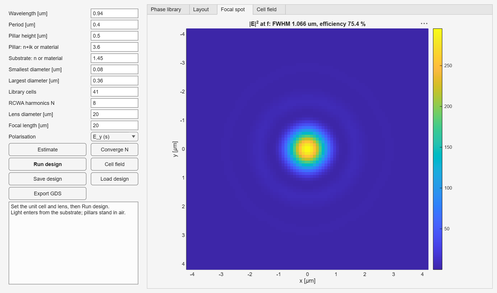
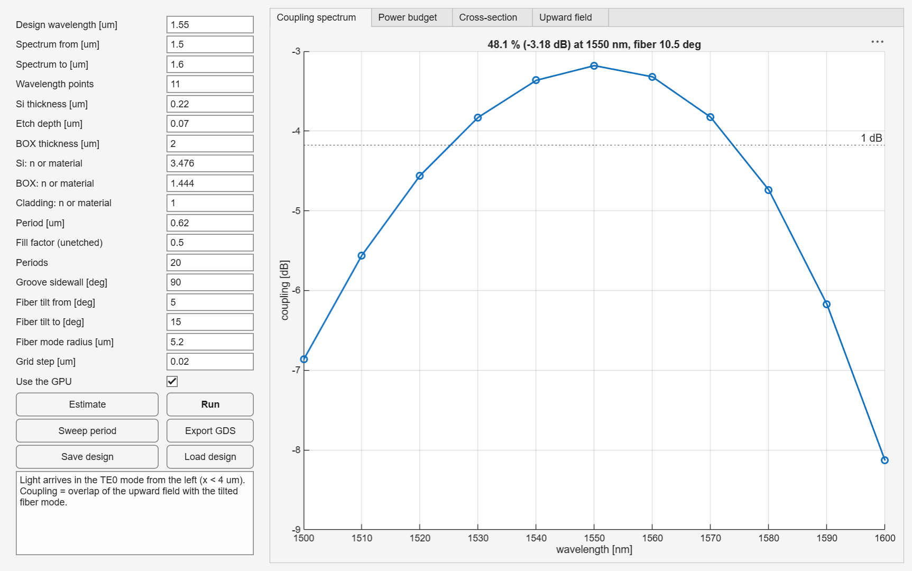

# OpticRCWAFDTD Tutorial · 使用教學

Step-by-step guides, from installation to your own structures. Each step is
given in English and then in Traditional Chinese.

從安裝到自己建立結構的逐步教學。每一步都先寫英文，再寫繁體中文。

**Contents · 目錄**

1. [Install and check · 安裝與檢查](#1-install-and-check--安裝與檢查)
2. [Your first five minutes · 前五分鐘](#2-your-first-five-minutes--前五分鐘)
3. [Design a metalens with the app · 用介面設計超穎透鏡](#3-design-a-metalens-with-the-app--用介面設計超穎透鏡)
4. [Design a grating coupler with the app · 用介面設計光柵耦合器](#4-design-a-grating-coupler-with-the-app--用介面設計光柵耦合器)
5. [Build your own structure in code · 用程式建立自己的結構](#5-build-your-own-structure-in-code--用程式建立自己的結構)
6. [Materials · 材料](#6-materials--材料)
7. [Import a GDSII layout · 匯入 GDSII 佈局](#7-import-a-gdsii-layout--匯入-gdsii-佈局)
8. [Inverse design · 反向設計](#8-inverse-design--反向設計)
9. [Which example should I read? · 該看哪個範例](#9-which-example-should-i-read--該看哪個範例)
10. [Troubleshooting · 常見問題](#10-troubleshooting--常見問題)

---

## 1. Install and check · 安裝與檢查

**Step 1.** Install one of three ways:

- **Add-On Explorer**: in MATLAB, *Home → Add-Ons → Get Add-Ons*, search *OpticRCWAFDTD*, click *Add*.
- **Toolbox file**: download the `.mltbx` from [GitHub Releases](https://github.com/MoonUsagi/OpticRCWAFDTD/releases) and double-click it.
- **Source**: clone the repository, `cd` into it and run `setupPaths`.

**步驟 1.** 三種安裝方式擇一：

- **附加元件瀏覽器**：MATLAB *首頁 → 附加元件 → 取得附加元件*，搜尋 *OpticRCWAFDTD*，按 *Add*。
- **Toolbox 檔**：從 [GitHub Releases](https://github.com/MoonUsagi/OpticRCWAFDTD/releases) 下載 `.mltbx` 後雙擊。
- **原始碼**：clone repo，`cd` 進資料夾後執行 `setupPaths`。

**Step 2.** Check what your machine supports:

**步驟 2.** 檢查環境支援哪些功能：

```matlab
orf.checkEnvironment
```

It reports the MATLAB version, whether a GPU can be used for FDTD, and the
toolbox version. Everything runs without a GPU.

會列出 MATLAB 版本、FDTD 能否使用 GPU，以及 toolbox 版本。沒有 GPU 也能執行所有功能。

**Step 3 (optional).** Run the test suite, about one minute:

**步驟 3（選做）.** 執行測試，約一分鐘：

```matlab
runAllTests("fast")
```

---

## 2. Your first five minutes · 前五分鐘

Open `examples/GettingStarted.m` and press **Run** (or run it section by
section with *Run Section*). In about 15 s you get five figures: a thin-film
coating (TMM), materials, a grating (RCWA), a metalens phase library and an
FDTD run checked against TMM.

打開 `examples/GettingStarted.m` 按 **Run**（或用 *Run Section* 一段一段執行）。
約 15 秒會產生五張圖：薄膜（TMM）、材料、光柵（RCWA）、超穎透鏡相位庫，以及與 TMM 對照的 FDTD。

Every function has help text. Type `help orf` for the list, or e.g.
`help orf.rcwa2D` for one function.

每個函式都有說明。輸入 `help orf` 看清單，或例如 `help orf.rcwa2D` 看單一函式。

---

## 3. Design a metalens with the app · 用介面設計超穎透鏡

```matlab
orf.MetalensDesigner
```



| Step | English | 中文 |
|---|---|---|
| 1 | Enter the wavelength, period and pillar height. Keep the period below λ / n<sub>substrate</sub> so only the zero order propagates. | 輸入波長、週期、柱高。週期要小於 λ / n<sub>基板</sub>，才只有零階繞射。 |
| 2 | Enter the pillar and substrate: an index (`3.6`, `2.4+0.01i`) or a built-in material name (`TiO2`, `Si3N4`, `SiO2`). | 輸入柱子與基板材料：折射率（`3.6`、`2.4+0.01i`）或內建材料名稱（`TiO2`、`Si3N4`、`SiO2`）。 |
| 3 | Set the smallest and largest diameter (leave a gap the fab can etch) and the lens diameter and focal length. | 設定最小、最大柱徑（留出製程可蝕刻的間距），以及透鏡直徑與焦距。 |
| 4 | Click **Estimate** to see the run time. | 按 **Estimate** 看預估時間。 |
| 5 | Click **Converge N** to choose the RCWA truncation automatically. | 按 **Converge N** 自動決定 RCWA 階數。 |
| 6 | Click **Run design**. A progress bar shows the steps; *Cancel* stops it. | 按 **Run design**，進度條顯示各步驟，*Cancel* 可中止。 |
| 7 | Check the tabs: *Phase library* (need ≥ 360° coverage and high T), *Layout*, *Focal spot* (FWHM vs the diffraction limit, efficiency). | 查看分頁：*Phase library*（相位涵蓋需 ≥ 360°、穿透率要高）、*Layout*、*Focal spot*（FWHM 與繞射極限、聚焦效率）。 |
| 8 | **Cell field** shows the field inside one pillar. | **Cell field** 顯示單根柱子內的場。 |
| 9 | **Save design** (JSON) and **Export GDS** (mask). Set the GDS layer numbers to your PDK. | **Save design**（JSON）與 **Export GDS**（光罩）。GDS 圖層號碼請依你的 PDK 設定。 |

The same flow from code (see `examples/metalens_tio2_visible.m`):

同樣的流程用程式寫（見 `examples/metalens_tio2_visible.m`）：

```matlab
p = struct('lambda0', 0.532, 'period', 0.30, 'height', 0.60, ...
           'pillar', orf.material("TiO2"), 'substrate', orf.material("SiO2"), ...
           'dMin', 0.08, 'dMax', 0.24, 'D', 20, 'f', 20);
r = orf.metalensDesign(p, Progress=orf.progressText());
r.metrics                                    % FWHM, efficiency, ...
orf.metalensToGDS("lens.gds", r.diameters, p.period);
```

---

## 4. Design a grating coupler with the app · 用介面設計光柵耦合器

```matlab
orf.GratingCouplerDesigner
```



| Step | English | 中文 |
|---|---|---|
| 1 | Enter the stack: Si thickness, etch depth, BOX thickness. Materials take an index or a name (`Si`, `SiO2`). | 輸入疊層：Si 厚度、蝕刻深度、BOX 厚度。材料可填折射率或名稱（`Si`、`SiO2`）。 |
| 2 | Enter the grating: period, fill factor, number of periods, sidewall angle. | 輸入光柵：週期、填充率、週期數、側壁角。 |
| 3 | Enter the fiber: tilt range and mode radius (5.2 µm for SMF-28 at 1550 nm). | 輸入光纖：傾角範圍與模場半徑（SMF-28 在 1550 nm 為 5.2 µm）。 |
| 4 | Click **Run** (one 2D FDTD run: ~45 s on a GPU, 2–3 min on a CPU). | 按 **Run**（一次 2D FDTD：GPU 約 45 秒，CPU 約 2–3 分鐘）。 |
| 5 | Read *Coupling spectrum* (peak and 1-dB band) and *Power budget* (up, down, reflected, transmitted; they must add to 1). | 看 *Coupling spectrum*（峰值與 1-dB 頻寬）和 *Power budget*（向上、向下、反射、穿透，四項相加應為 1）。 |
| 6 | **Sweep period** tries five periods around the current one and keeps the best. | **Sweep period** 在目前週期附近試五個值，保留最佳。 |
| 7 | **Export GDS** writes the grating and taper. | **Export GDS** 輸出光柵與 taper。 |

For apodized gratings use `orf.optimizeGratingCoupler` (`examples/cpo_grating_optimize.m`, ~1.5 h).

漸變光柵請用 `orf.optimizeGratingCoupler`（`examples/cpo_grating_optimize.m`，約 1.5 小時）。

---

## 5. Build your own structure in code · 用程式建立自己的結構

A structure is built in four steps: materials → shapes → layers → structure.

結構分四步建立：材料 → 形狀 → 層 → 結構。

```matlab
% 1. materials · 材料
air   = orf.material("air");
glass = orf.material("SiO2");
tio2  = orf.material("TiO2");

% 2. shapes inside the unit cell (centred at 0) · 單元內的形狀（中心在原點）
pillar = orf.shapeCircle(0.10, tio2);                 % radius 0.1 um
% also: orf.shapeRect(wx, wy, mat), orf.shapePolygon(xy, mat)

% 3. layers, listed from the incident side · 層，從入射側開始排
layer = orf.makeLayer(0.6, air, {pillar});           % thickness, background, shapes

% 4. structure: period [Lx Ly], incident medium, substrate, layers
%    結構：週期 [Lx Ly]、入射介質、出射基板、各層
dev = orf.makeStructure([0.3 0.3], glass, air, {layer});

% simulate · 模擬
out = orf.rcwa2D(dev, 0.532, 0, 0, "s", Nx=7);
fprintf('T = %.3f, R = %.3f\n', out.Ttot, out.Rtot)
```

**Reading the result · 讀結果**

| Output | Meaning | 意義 |
|---|---|---|
| `out.Ttot`, `out.Rtot` | total transmitted / reflected power | 總穿透／反射功率 |
| `out.T`, `out.R` | power per diffraction order `(out.m, out.n)` | 各繞射階 `(out.m, out.n)` 的功率 |
| `out.t`, `out.r` | complex field amplitudes `[Ex; Ey; Ez]` per order (phase!) | 各階複數場振幅 `[Ex; Ey; Ez]`（含相位） |

**Polarisation · 偏振**: `"s"` (TE; E along y at normal incidence), `"p"` (TM; E along x),
or a Jones vector `[aTE aTM]`, e.g. `[1i 1]/sqrt(2)` for circular light.

`"s"`（TE，正入射時 E 沿 y）、`"p"`（TM，E 沿 x），或 Jones 向量 `[aTE aTM]`，例如圓偏振光為 `[1i 1]/sqrt(2)`。

**Conventions · 慣例**: lengths in µm, angles in radians, time dependence exp(−iωt),
lossy materials have Im(n) > 0. See [CONVENTIONS.md](CONVENTIONS.md).

長度單位 µm、角度單位弧度、時間相依 exp(−iωt)、有損材料 Im(n) > 0。詳見 [CONVENTIONS.md](CONVENTIONS.md)。

**Convergence · 收斂**: raise `Nx` until the result stops changing, or let
`orf.convergeN` do it (`examples/workflow_scripting.m`). Check the cost first
with `orf.estimateResources`.

增加 `Nx` 直到結果不再變化，或交給 `orf.convergeN` 自動處理（見 `examples/workflow_scripting.m`）。
執行前先用 `orf.estimateResources` 估算成本。

**Fields · 場分佈**: `orf.rcwaFields(dev, lambda0, theta, phi, pol, x, y, z, Nx=...)`
returns E and H on any grid (`examples/rcwa_fields_pillar.m`).

`orf.rcwaFields` 可在任意網格上算出 E 與 H（見 `examples/rcwa_fields_pillar.m`）。

**Sloped sidewalls · 斜側壁**: replace the layer with
`orf.slantedLayers(h, background, shape, angleDeg)` (`examples/sidewall_angle_study.m`).

把該層換成 `orf.slantedLayers(h, background, shape, angleDeg)`（見 `examples/sidewall_angle_study.m`）。

---

## 6. Materials · 材料

| Function | Use for | 用途 |
|---|---|---|
| `orf.material("TiO2")` | built-in dispersion: air, SiO2, Si, Si3N4, TiO2, Al2O3 | 內建色散材料 |
| `orf.materialTaucLorentz(A, E0, C, Eg, epsInf)` | amorphous films (a-Si, SiNx) from ellipsometry | 非晶薄膜（a-Si、SiNx），用橢偏儀參數 |
| `orf.materialTable(lambda, n, k)` | any measured n, k table | 任何實測 n, k 表 |
| `orf.materialConst(3.6)` | a constant index | 固定折射率 |

Example: `examples/materials_dispersion.m`. A material is only valid inside
its range; outside it you get an error, not an extrapolation.

範例見 `examples/materials_dispersion.m`。材料只在有效波長範圍內可用，超出範圍會報錯，不會外插。

---

## 7. Import a GDSII layout · 匯入 GDSII 佈局

```matlab
lib   = orf.gdsRead("design.gds");                   % polygons, boxes, paths, references
polys = orf.gdsFlatten(lib, Layer=1);                % absolute coordinates of layer 1
shapes = orf.gdsToShapes(polys, tio2, [x0 y0]);      % centred on the unit cell at (x0, y0)
layer = orf.makeLayer(0.6, air, shapes);
```

PATH elements (waveguides, wires) are converted to polygons with mitred
corners. To write layouts use `orf.gdsWrite` (polygons, paths and cell references),
`orf.metalensToGDS` or `orf.gratingToGDS`.

PATH 元件（波導、導線）會轉成斜接轉角的多邊形。輸出佈局用 `orf.gdsWrite`（多邊形、路徑、cell 參照）、
`orf.metalensToGDS` 或 `orf.gratingToGDS`。

---

## 8. Inverse design · 反向設計

Instead of choosing a period and fill factor, let the optimiser choose every
pixel of the etch pattern. `orf.inverseDesignGratingCoupler` uses the adjoint
method: per wavelength, one frequency-domain solve (`orf.fdfd2D`) and one
adjoint solve give the gradient for all pixels at once.

不再手動選週期與填充率，而是讓最佳化器決定蝕刻圖案的每個像素。`orf.inverseDesignGratingCoupler` 使用
adjoint 方法：每個波長只要一次頻域求解（`orf.fdfd2D`）加一次伴隨求解，就能得到所有像素的梯度。

```matlab
p = struct('process', "overlay", 'thetaDeg', 10, 'lambdas', 1.55);   % stack: gratingCouplerTE defaults
res = orf.inverseDesignGratingCoupler(p, MinFeature=0.10, Progress=orf.progressText());
res.eta, res.x0                                  % coupling, fiber position from the grating start
fd = orf.gratingCouplerTE(struct('layout', res.layout, 'lambdas', 1.55));   % FDTD check
eta = orf.fiberCoupling(fd, deg2rad(10), 4 + res.x0, 5.2)
res.masks                                        % openings / overlay per mask, for GDSII
```

| Step | English | 中文 |
|---|---|---|
| 1 | Choose the process: `shallow` (one etch; at most ~57 % goes up, the rest leaks into the substrate) or `overlay` (etch + poly-Si; ~93 % up). Fix the stack, fiber angle and design wavelengths; several wavelengths trade peak for bandwidth. The fiber position is optimised too. | 選製程：`shallow`（單次蝕刻，最多約 57% 往上，其餘漏進基板）或 `overlay`（蝕刻＋多晶矽，約 93% 往上）。固定疊層、光纖角度與設計波長；多個波長會用峰值換頻寬。光纖位置也會一起最佳化。 |
| 2 | Set `MinFeature` to your lithography limit; the filter and the final clean-up enforce it. | `MinFeature` 設成微影極限；濾波與最後的清理會確保不小於它。 |
| 3 | The design starts grey and is pushed to 0/1 in stages (`Betas`); a polish stage repairs what the feature clean-up breaks. Compare `res.etaGrey` with `res.eta`. | 設計從灰階開始，分階段（`Betas`）推向 0/1；最後的 polish 階段修補清除小特徵造成的損失。可比較 `res.etaGrey` 與 `res.eta`。 |
| 4 | Always check the final binary design with the FDTD (an independent solver), as in the example. | 最後的二值設計一定要用 FDTD（獨立求解器）驗證，見範例。 |

Example: `examples/inverse_design_grating_coupler.m`.

範例：`examples/inverse_design_grating_coupler.m`。

---

## 9. Which example should I read? · 該看哪個範例

| I want to … | 我想要… | Example |
|---|---|---|
| see everything quickly | 快速看全部功能 | `GettingStarted.m` |
| use dispersive or measured materials | 用色散或實測材料 | `materials_dispersion.m` |
| design a metalens (NIR, a-Si) | 設計近紅外 a-Si 超穎透鏡 | `metalens_demo_940nm.m` |
| design a visible metalens (TiO2) | 設計可見光 TiO2 超穎透鏡 | `metalens_tio2_visible.m` |
| use geometric (PB) phase | 用幾何相位（PB phase） | `metasurface_pb_phase.m` |
| know the effect of sloped sidewalls | 了解斜側壁的影響 | `sidewall_angle_study.m` |
| see the field inside a unit cell | 看單元內的場分佈 | `rcwa_fields_pillar.m` |
| check a metalens with full-wave 3D FDTD | 用三維 FDTD 驗證超穎透鏡 | `metalens_fullwave_3d.m` |
| design a narrow-band resonant filter | 設計窄頻共振濾波器 | `gmr_filter.m` |
| find waveguide modes and group index | 求波導模態與群折射率 | `waveguide_modes_soi.m` |
| design a fiber grating coupler | 設計光纖光柵耦合器 | `cpo_grating_coupler_1550.m` |
| inverse-design a grating coupler (adjoint) | 用反向設計（adjoint）做光柵耦合器 | `inverse_design_grating_coupler.m` |
| optimise an apodized coupler | 最佳化漸變光柵耦合器 | `cpo_grating_optimize.m` |
| automate studies (estimates, sweeps) | 自動化研究（估算、掃描） | `workflow_scripting.m` |
| export masks | 輸出光罩 | `export_gds.m` |

---

## 10. Troubleshooting · 常見問題

| Symptom | Cause and fix | 原因與解法 |
|---|---|---|
| `wavelength outside ... range` | The material is not defined there. Use another material or your own table. | 材料在該波長沒有定義。換材料或用自己的 n,k 表。 |
| Results change with `Nx` | Not converged. Raise `Nx` or use `orf.convergeN`; metals and TM need more. | 尚未收斂。提高 `Nx` 或用 `orf.convergeN`；金屬與 TM 需要更多階數。 |
| Out of memory in RCWA | Memory grows as N⁴. Check `orf.estimateResources` first; lower `BatchSize`. | 記憶體隨 N⁴ 成長。先用 `orf.estimateResources` 檢查，或調低 `BatchSize`。 |
| FDTD is slow | Enable the GPU (`sim.useGPU = true`, or the app's *Use the GPU*), or use a coarser grid to explore first. | 開啟 GPU（`sim.useGPU = true` 或介面勾選 *Use the GPU*），或先用較粗的網格探索。 |
| Phase library covers < 360° | Taller pillars, a higher-index material, or a wider diameter range. | 柱子加高、改用高折射率材料，或擴大柱徑範圍。 |
| R + T ≠ 1 | Expected with lossy materials (absorption). For lossless ones it signals too few harmonics. | 有損材料會吸收，屬正常；無損材料則代表階數不足。 |

Questions and bug reports: [GitHub Issues](https://github.com/MoonUsagi/OpticRCWAFDTD/issues).

問題與錯誤回報：[GitHub Issues](https://github.com/MoonUsagi/OpticRCWAFDTD/issues)。
